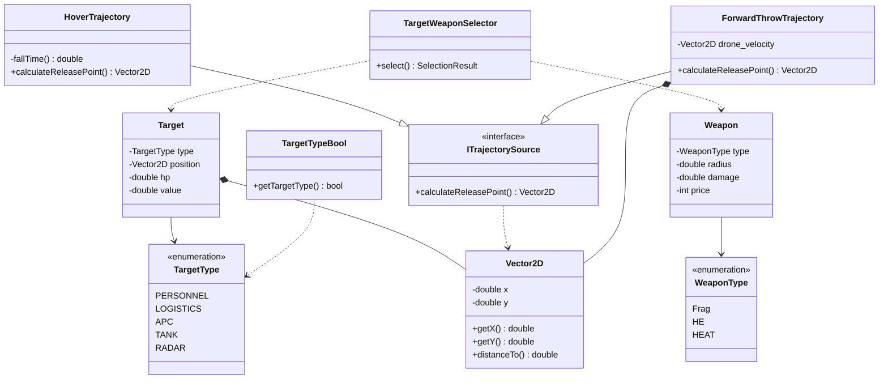

<h1>Модуль-ядро системи донаведення для скиду боєприпасу з дрона-коптера, побудована на C++.</h1>
Побудований для роботи також з додатковими модулями - пакетним запуском, мережевим сервісом і операторською консоллю;

<h2>Формат вводу:</h2>

Перша команда в терміналі для компіляції - g++ -std=c++17 -Wall -Wextra main.cpp -o drop_calc

<h3>Приклад 1 — запуск на одному файлі через аргументи:</h3>
./drop_calc --input-file scenario.txt --output-file result.txt --trajectory hover|forward - Порядок аргументів не фіксований, модель траєкторії за замовчуванням
hover.

<h3>Приклад 2 — пакетна обробка теки - використовує run-all.sh:</h3>  

./run-all.sh 

<h3>Приклад 3 — запуск у контейнері - використовує Dockerfile:</h3>
  
docker build -t drop-calc .  
docker run --rm drop-calc

<h2>Формат виводу:</h2>

<h3>Приклад 1 — запуск на одному файлі через аргументи:</h3>
Один output-file 

<h3>Приклад 2 — пакетна обробка теки - використовує run-all.sh :</h3> 

input/mission-a.txt → output/mission-a-result.txt  
input/mission-b.txt → output/mission-b-result.txt

<h3>Приклад 3 — запуск у контейнері - використовує Dockerfile:</h3>  

Вивід по всім файлам в теці Input;  
Друк результатів в терміналі;  
Для збереження в теці Output виклик: docker run --rm -v "$(pwd)/output:/app/output" drop-calc

<h2>Приклад роботи:</h2>

<h3>При вхідних даних:</h3>  

120.0  
5.0 0.0  
4  
300.0 400.0 20 LOGISTICS  
300.0 450.0 15 PERSONNEL  
260.0 380.0 15 PERSONNEL  
340.0 380.0 15 PERSONNEL  

Де:  

altitude_m  
wind_x wind_y  
count  
x y hp type ← рядок цілі, повторюється count разів 

<h3>Отримуємо результат:</h3>  

300.00 400.00  
275.27 400.00  
Frag  
4 50 35 15  

Де:  

impact_x impact_y ← краща точка влучання  
release_x release_y ← точка скиду з урахуванням вітру  
<назва боєприпасу> ← Frag / HE / HEAT  
destroyed value_sum price net

## Діаграма класів  

